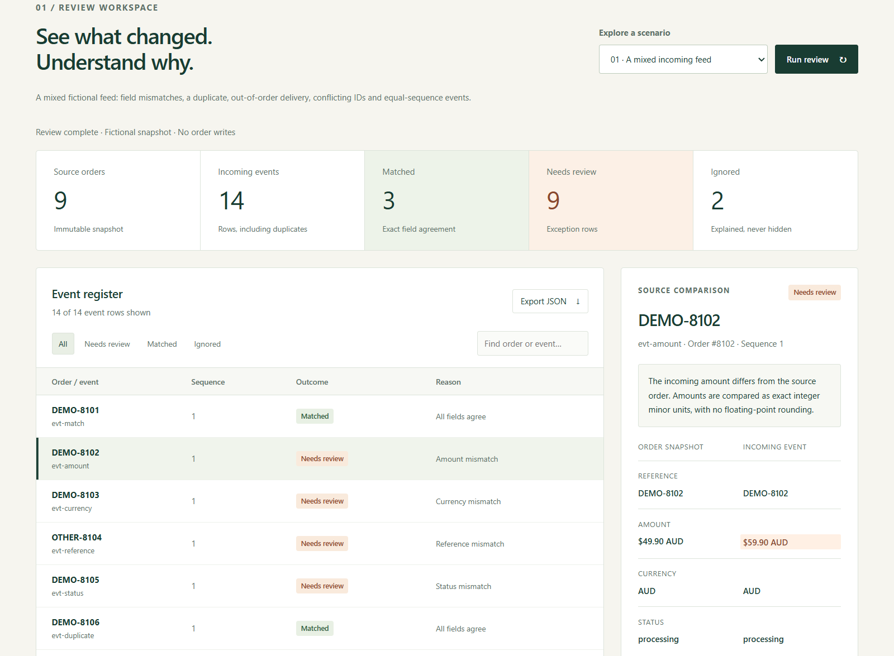

# Commerce Reconcile + Commerce Canvas

**An original WordPress engineering and design showcase by Dhruba Poudel.**

Commerce Reconcile compares an incoming commerce-event snapshot with exact order records. Commerce Canvas supplies a custom WordPress theme, an original visual identity and a fictional catalogue. The projects connect backend rules, WordPress integration and interface design while keeping their evidence and delivery stage explicit.

[Try the PHP demonstration](https://about.dhrub.com.np/commerce/) · [Explore the theme](https://about.dhrub.com.np/commerce/theme/preview/) · [Brand guide](https://about.dhrub.com.np/commerce/brand/) · [Portfolio](https://about.dhrub.com.np/)

## What is included

| Layer                       | Responsibility                                                                                                | Scope                                                                                                                                          |
| --------------------------- | ------------------------------------------------------------------------------------------------------------- | ---------------------------------------------------------------------------------------------------------------------------------------------- |
| `plugin/commerce-reconcile` | Original WordPress plugin, authenticated REST route and bounded WooCommerce exact-ID reader                   | Reads records and returns a report. No order, cart or payment mutations.                                                                       |
| PHP domain engine           | Strict schema validation, exact comparisons, duplicate/conflict/sequence rules and reproducible report hashes | Pure analysis; it does not persist a ledger or apply events.                                                                                   |
| `web`                       | Public demonstration calling that same PHP engine                                                             | Four bundled fictional scenarios. No arbitrary payload, URL, credentials, live store or external API request.                                  |
| `theme`                     | Original installable Commerce Canvas classic theme                                                            | Fictional fallback catalogue plus optional published WooCommerce products. Cart/payment configuration belongs to WooCommerce and the merchant. |
| `brand`                     | Original identity guide, palette, typography, spacing and authored SVG illustrations                          | Fictional brand and products, with no client or business-performance claims.                                                                   |



## The important implementation decisions

- Amounts use integer minor units. Unsupported precision is rejected rather than silently rounded.
- Exact order IDs are used. A missing order is an exception, not a fuzzy match.
- Reusing an event ID with a changed canonical payload holds the conflicting versions.
- Exact duplicate deliveries and explicitly supplied prior-ledger replays are explained and ignored.
- Lower admissible sequences cannot win through arrival order. Equal highest sequences from different IDs remain ambiguous.
- Reports retain the original snapshot and incoming values. SHA-256 identifies exact report/source values; it is not a signature or proof of source truth.
- The WordPress REST route checks both a capability and a REST nonce. Input containers and fields are validated before any WooCommerce reads.
- The public interface handles expired requests, failed HTTP responses and stale replies, and keeps the inspector aligned with the filtered register.

The [core contract](docs/core-contract.md) documents precedence, bounded input, the distinction between an observed watermark and applied state, and canonical hashing.

## Reproduce the public demonstration

Requires PHP 8.1 or later and Python 3. Build the small deployment directory from the source:

```sh
python scripts/build_showcase.py --output release
php -S 127.0.0.1:8038 -t release
```

Open `http://127.0.0.1:8038/`. The build packages the plugin/theme downloads and copies only the runtime preview assets. Node.js is needed for development checks, not for serving the demonstration.

## Run the checks

With PHP, Python 3, Node.js 24+ and pnpm 11.25.0 available:

```sh
pnpm install --frozen-lockfile --ignore-scripts
php tests/run.php
php tests/demo-endpoint.php
node --test tests/showcase.test.mjs theme/tests/interaction.test.mjs
python theme/tools/check_theme.py --php php
```

`COMMERCE_PHP_BIN` can select a specific PHP executable for the interface tests. Development dependencies are locked and do not run lifecycle scripts during installation.

## Verification and delivery stage

The [release verification](docs/release-verification.json) separates standalone PHP checks, simulated-DOM interface checks, actual WordPress/WooCommerce runtime checks, browser checks and hosted verification. Those layers are distinct evidence.

The baseline fixture has **9 fictional source orders and 14 incoming event rows: 3 matched, 9 exception rows and 2 ignored**. Those counts are not business results. Four corrected field mismatches yield 7 matched, 5 exception rows and 2 ignored; identity/sequence conflicts and the missing order remain visible.

Actual local integration was checked using **WordPress 7.1.3, WooCommerce 11.2.1, PHP 8.5.12 and SQLite Database Integration 3.1.1**. The isolated development site blocks external HTTP requests and mail. The plugin was also checked in real WordPress without WooCommerce. Tests that create fictional users/orders/products clean up their own fixture records.

The public PHP demo is hosted independently of WordPress. The theme link is its static design preview. Neither is a live retail store. These checks do not establish production qualification, all database/HPOS combinations, all payment gateways or WordPress.org directory approval.

## Install and review the WordPress components

Download the plugin/theme ZIPs from the [showcase](https://about.dhrub.com.np/commerce/) or build them with the command above. Install them through the normal WordPress plugin/theme upload screens in an isolated development site first. The plugin appears under **Tools → Commerce Reconcile**. Start with its bundled fictional payload.

The [plugin guide](plugin/commerce-reconcile/README.md) documents the REST request and permissions. The [theme guide](theme/README.txt) covers the fallback catalogue, WooCommerce product display and template responsibilities. No credentials, private source, real customer records or database files are included in this repository.

## Authorship and licence

Original project code, theme, interface, brand system and SVG artwork: **Dhruba Poudel**. GPL-2.0-or-later; the original GNU licence text is retained in [LICENSE](LICENSE). WordPress, WooCommerce and third-party development dependencies retain their own authorship, licences and trademarks. This independent project is not affiliated with their maintainers.
