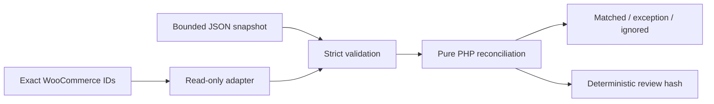

# Reconciliation contract

Author and maintainer: **Dhruba Poudel**.

## Separation of concerns

`Reconciler` and `CanonicalJson` are pure PHP. They have no WordPress functions, network access, database calls or file writes. `WooCommerceAdapter` reads exact order IDs through the public factory. `Plugin` owns the WordPress capability, CSRF, REST, escaping and UI boundaries.

An external `status` means a normalised order-state value, not an arbitrary courier-state vocabulary. A real connector must deliberately map its provider vocabulary into this contract. The prototype does not imply that every fulfilment platform uses WooCommerce's statuses.

## Input

`orders` and `events` must be JSON arrays, including when empty (`[]`). An empty object (`{}`) or an object with numeric-looking keys is rejected before associative decoding can collapse the distinction. Orders contain exactly `order_id`, `reference`, `amount_minor`, `currency`, `status`. Events contain those fields plus `event_id`, `sequence`, `occurred_at`. Unknown fields are rejected, helping avoid accidental inclusion of customer information or credentials.

| Field | Accepted value |
| --- | --- |
| `order_id` | Integer 1–2,147,483,647 |
| `reference` | 1–64 ASCII identifier characters: alphanumeric first, then alphanumeric, `.`, `_`, `:`, `-` |
| `amount_minor` | Integer 0–100,000,000; caller and adapter must agree on the currency's minor-unit precision |
| `currency` | Three uppercase ASCII letters; this validates form, not membership in an ISO currency registry |
| `status` | `pending`, `processing`, `completed`, `on-hold`, `cancelled`, `refunded`, `failed` |
| `event_id` | Same identifier characters as reference, but must start with an ASCII letter |
| `sequence` | Integer 1–1,000,000; monotonic per order, supplied by the normalised connector |
| `occurred_at` | Exact valid `YYYY-MM-DDTHH:MM:SSZ`; timestamp is evidence, not the ordering authority |

At most 500 orders, 1,000 events and 256 KiB JSON are accepted. JSON nesting is bounded to 20 levels. `analyse()` validates array inputs; callers decoding untrusted JSON should use `decode()` first to enforce byte/depth limits. A malformed row rejects the whole analysis before a report is returned. These application checks do not replace web-server request-size and resource limits.

## Rule precedence

1. Group each event ID by its canonical payload fingerprint. If an ID has different payloads in the same batch, **every version is an `event_id_conflict` exception**. No arrival wins.
2. If a trusted prior ledger has that ID with a different fingerprint, hold it as a conflict. If its fingerprint agrees, ignore it as `event_replay`.
3. Ignore a later identical appearance in the same batch as `duplicate_event`.
4. Precompute the maximum admissible sequence for each order over the whole batch and trusted prior sequence map. Ignore lower events as `stale_event`, so input order cannot make an old update win.
5. Ignore an event at or below a trusted prior observed sequence.
6. If multiple distinct event IDs share the same maximum sequence for an order, hold them as `sequence_conflict`; the engine does not guess a winner.
7. Compare that candidate to its source order. Missing IDs are exceptions. Reference, amount, currency and status differences are individually reported. Exact equality is matched.

Rows retain input order and original values. The maximum is an **observed-sequence watermark**, not proof that any order update was applied. There are no applied order updates. Conflicts are not written into the returned event ledger. A real incremental connector must provide its own durable, transactional journal and recovery policy; the optional trusted prior state is a domain/testing contract, not such a store.

The returned ledger maps event IDs to SHA-256 canonical payload fingerprints. The returned sequence map records the highest observed admissible sequence. Prior maps are bounded, with conservative combined limits of 5,000 prior entries plus current event rows. The WordPress/public-demo boundaries do not accept a user-supplied prior ledger.

## Reproducible evidence

`CanonicalJson::encode()` recursively sorts associative keys with PHP string ordering, preserves list order and encodes UTF-8 without escaping Unicode or slashes. `report_hash` is SHA-256 of the complete report before the `report_hash` field is added. This is a project-defined evidence format, **not** an implementation of RFC 8785, a signature, an authenticity proof or a privacy guarantee.

Same snapshot, same report bytes and hash. A report produced with explicit prior state intentionally has replay/stale dispositions, so it is a different report. Re-analysis does not retry an external side effect. The public demonstration and admin adapter make no outbound provider requests.

Baseline fixture: **9 orders, 14 event rows, 3 matched, 9 exception rows, 2 ignored**. Nine exception rows are not nine unique affected orders: both sides of a conflict are visible.

Baseline review hash: `f778c64d0541de0819a75943446aaa1a3de779eec274df32c1b09e70482879b9`.
